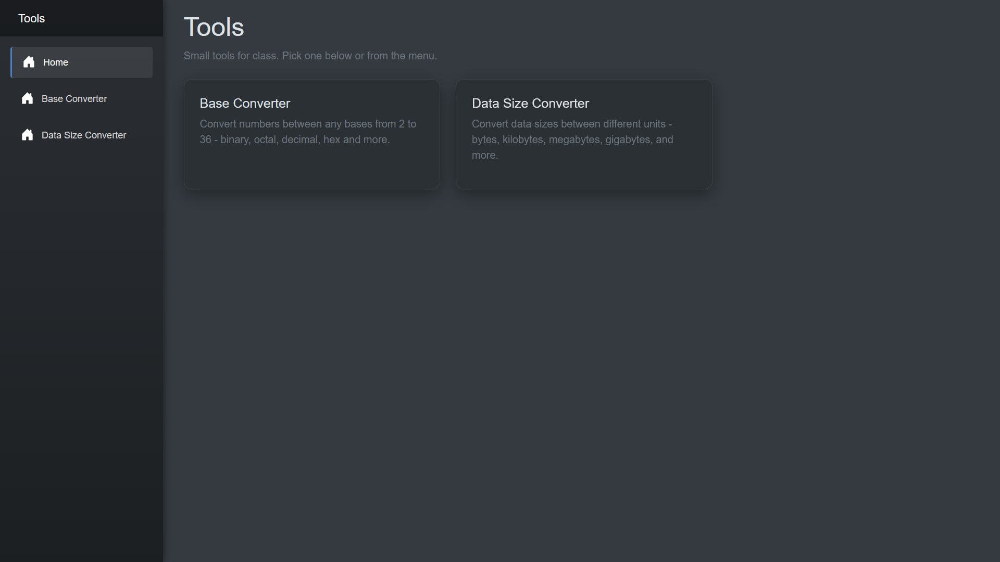

# Tools

Small collection of web tools for my class at data- og kommunikationsuddannelsen - built with C# and Blazor WebAssembly.

Built to practice C# and web development, and hopefully give my classmates some useful tools for our assignments.

**Try it live:** https://ivaneriksen.github.io/Tools/



## Tools

- **Base Converter** - convert numbers between any bases from 2 to 36 (binary, octal, decimal, hex and more). Validates input and gives clear error messages for invalid digits, bases and numbers that are too large.
- **Data Size Converter** - enter an amount and a unit and see it in all units at once: bits, bytes, network units (kbit, Mbit...), decimal units (kB, MB...) and binary units (KiB, MiB...). Updates live as you type.

## Tech stack

- C# / .NET 10
- Blazor WebAssembly
- Bootstrap 5 with a custom dark theme
- GitHub Actions for automatic build and deployment
- GitHub Pages for hosting

## Project structure

```
Tools.sln
├── BaseConverter.Core     Class library with the logic for all tools (no UI)
├── BaseConverter.Web      Blazor WebAssembly site (pages, layout, styling)
└── BaseConverter          Console app used for testing the logic
```

## Run locally

Requirements: .NET 10 SDK and Visual Studio (or another C# editor).

1. Clone the repo: `git clone https://github.com/ivaneriksen/Tools.git`
2. Open `Tools.sln` in Visual Studio.
3. Set `BaseConverter.Web` as the startup project.
4. Smash your head against the keyboard until you hit F5.

## Deployment

Every push to `master` triggers a GitHub Actions workflow (`.github/workflows/deploy.yml`) that publishes the site and deploys it to GitHub Pages.
